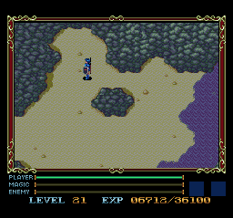
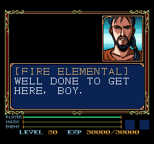
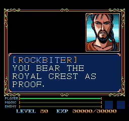

# Xak I — PC Engine CD English Beta 2.1

An experimental English playtest patch for **Xak I** on the Japanese **Xak I & II** PC Engine CD disc. **Xak II is not included in this translation beta.**

## Download

[Download the Beta 2.1 patch ZIP](https://github.com/shadowfire-36/Xak-I-PCE-English-Beta/raw/refs/heads/main/Xak_I_English_Beta_2_1.zip)

Use [Delta Patcher](https://github.com/marco-calautti/DeltaPatcher/releases) to apply the included xdelta patch to a **copy** of your matching original raw disc image. No game image or BIOS is included.

[Step-by-step installation](INSTALLATION.txt) · [Checksums](CHECKSUMS.json) · [Report a bug](https://github.com/shadowfire-36/Xak-I-PCE-English-Beta/issues)

## Beta 2.1 startup-load hotfix

Beta 2 missed shared startup-load text outside the Game I event range. This update covers all 94 source copies of the blessing, including a spelling variant. Apply to the clean original and restart from the updated CUE. An old emulator snapshot can still restore old cached code/text.

## Changes in Beta 2

- The two reported help scenes now ask **WILL YOU HELP?**, preserving YES/NO choices. Unrelated questions retain their meanings.
- The loading-screen blessing is now English.
- Item and quest-name tables are translated across all 36 matching Game I menu copies. Short names fit the original menu width. Additional missed equipment-name copies are translated.
- Apply this patch to the clean original image, **not an already patched Beta 1 image**. Restart the emulator with the new CUE; old save states can restore cached Japanese text. Back up saves.

The patch round-trip, changed-sector integrity, menu pointer tables, native text rendering and title-to-town disc loading were checked. Every natural quest/item path still needs playtesting.

[Earlier Beta 1 download](https://github.com/shadowfire-36/Xak-I-PCE-English-Beta/raw/refs/heads/main/Xak_I_English_Beta_1.zip) remains available.

## Required image

Whole-disc RAW image with 2352-byte sectors; **563,057,040 bytes**. A CHD, separate-track set or 2048-byte ISO is not this input; changing an extension does not convert it.

| Image | CRC32 |
|---|---|
| Exact original | `6BD28D3D` |
| Patched Beta 2 | `8694DA8E` |

Full SHA-256 values are in the instructions and checksums file. Keep checksum validation enabled in your patcher.

## Beta scope and limits

The exported source register contains 1,169 Japanese/English pairs spanning dialogue, shop text, equipment labels and system messages. This is source coverage, **not proof of a full natural playthrough**.

- A complete natural playthrough and every choice branch are not verified.
- **Normal in-game saving needs testing.** Saving stalled from an imported cave snapshot in both older and beta builds. Private Mesen save-state creation/reload passed. Back up saves and report problems.
- Japanese cinematic audio and movie staff-credit graphics remain unchanged.
- Actual hardware compatibility is not verified by the private emulator tests.

## Testing help wanted

Please report untranslated text, clipping, wrong speakers, crashes, save problems or progression blockers. Include emulator/version, scene, screenshot, reproduction steps and an optional save state. Avoid posting game images or BIOS files.

## Credits

**Original MSX English translation: Rieks Warendorp Torringa.**

PC Engine adaptation and beta project: **Jason / shadowfire-36**. The MSX script served as a reference, with PCE-specific differences handled separately. This independent beta is not a WOOMB-authored or endorsed PCE release; exact extracted-script edition identification remains under review.

## Screenshots

The cave capture is a loaded beta gameplay checkpoint. The two dialogue images are native renderer tests captured with Beta 1, not evidence of naturally reached story progression.
